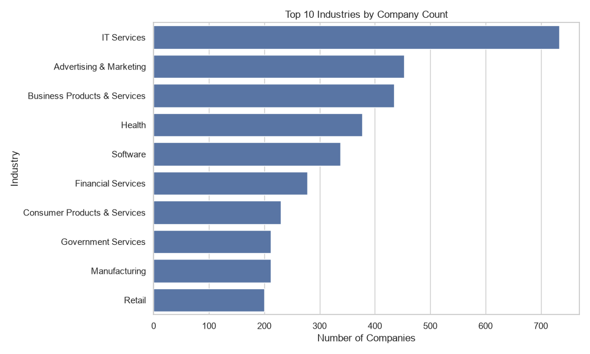
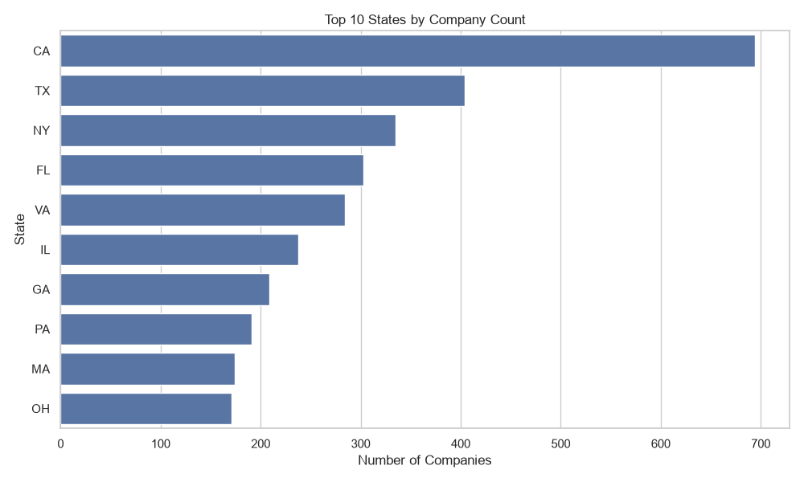
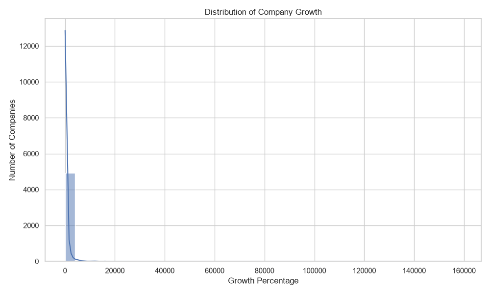
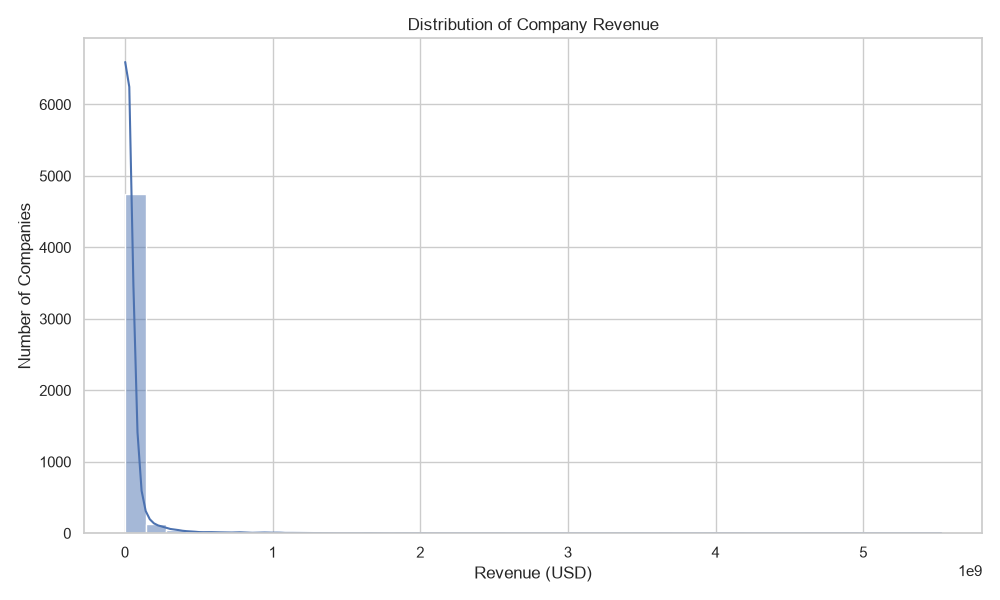

# Exploratory Data Analysis of INC 5000 Companies (2014)

## Project Overview
This project performs Exploratory Data Analysis (EDA) on the INC 5000 Company List dataset from 2014.

The objective is to explore company growth, revenue, industries, and geographical distribution using Python.

**Note:** This project analyses historical 2014 data and does not represent current company performance.

## Tools and Technologies
- Python
- Pandas – Data loading and data analysis
- NumPy – Numerical operations
- Matplotlib – Data visualisation
- Seaborn – Statistical charts
- VS Code – Development environment

## Dataset Information
- Total Records: 5,000 companies
- Total Original Columns: 19
- Dataset: INC 5000 Company List (2014)

## Data Cleaning
- Checked missing values.
- Checked duplicate records.
- Removed unnecessary metadata columns.
- Generated a cleaned CSV file for further analysis.

## Exploratory Data Analysis
The analysis includes:
- Dataset overview and statistical summary.
- Top 10 industries by company count.
- Top 10 states by company count.
- Company growth analysis.
- Company revenue analysis.
- Identification of the top 10 companies by growth.

## Key Findings
1. IT Services is the most represented industry, with 733 companies.
2. California has the highest number of companies, with 694.
3. The average company growth is approximately 516.44%.
4. The average reported revenue is approximately 43.06 million.
5. Company growth and revenue distributions are strongly right-skewed, with a small number of extreme values.

## Visualisations

### Top 10 Industries

### Top 10 States

### Company Growth Distribution

### Company Revenue Distribution

## Project Files
- `eda_analysis.py` – Python code for EDA.
- `data/` – Original dataset.
- `cleaned_inc5000.csv` – Cleaned dataset.
- `charts/` – Generated visualisations.

## Conclusion
This project helped explore the INC 5000 company dataset and identify patterns in company growth, revenue, industries, and geographical distribution using Python.